+++
title = "Do-it-yourself Fahrrad-Kofferraum auf Rädern"
date = 2026-11-09
description = "Selbstbauanleitung für einen Fahrrad-Lastenanhänger auf Basis des Carry Freedom Y-Frames."
+++

Wer öfter mit dem Fahrrad zum Einkaufen fährt, kennt das: die Packtaschen sind doch wieder drei Liter zu klein, schon wieder baumelt ein Beutel am Lenker und schlenkert in die vorderen Speichen oder der viel zu voll gestopfte Rucksack drückt. Ein Kofferraum wäre jetzt schön. Alle, die eine flexiblere und günstigere Lösung als ein Lastenfahrrad oder ein Auto für dieses Problem suchen, finden hier eine einfache Anleitung für den Fahrrad-Kofferraum auf Rädern:

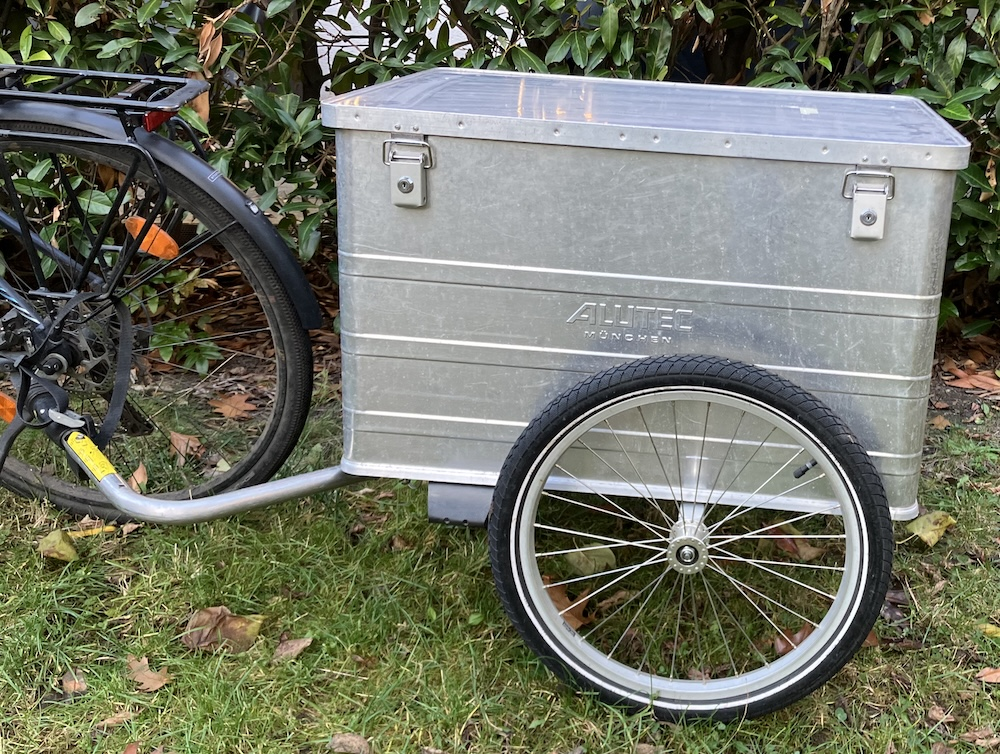

Groß genug für zwei Gitterboxen nebeneinander, abschließbar (wenn man mehrere Läden ansteuert, ist das praktisch), wasserdicht und für alle Fahrräder geeignet:

*Die Bilder für die folgende Anleitung wurden aufgenommen, nachdem sich der Anhänger eine Weile in der Praxis bewährt hat. Infolgedessen sind die einzelnen Teile nicht mehr ganz sauber und zeigen auch deutliche Gebrauchsspuren.*

## Basis: Carry Freedom Y-Frame und eine Alubox

Die Basis des Anhängers bildet der große [Y-Frame](https://carryfreedom.com/de/shop/the-y-trailers-de/the-y-large-version-2-2/) von [Carry Freedom](https://carryfreedom.com/de) mit einer Grundplatte von 50x70cm. Hier ist eine ältere Version zu sehen, die wir verbaut haben. Die neueren sind aber in den wesentlichen Punkten baugleich:

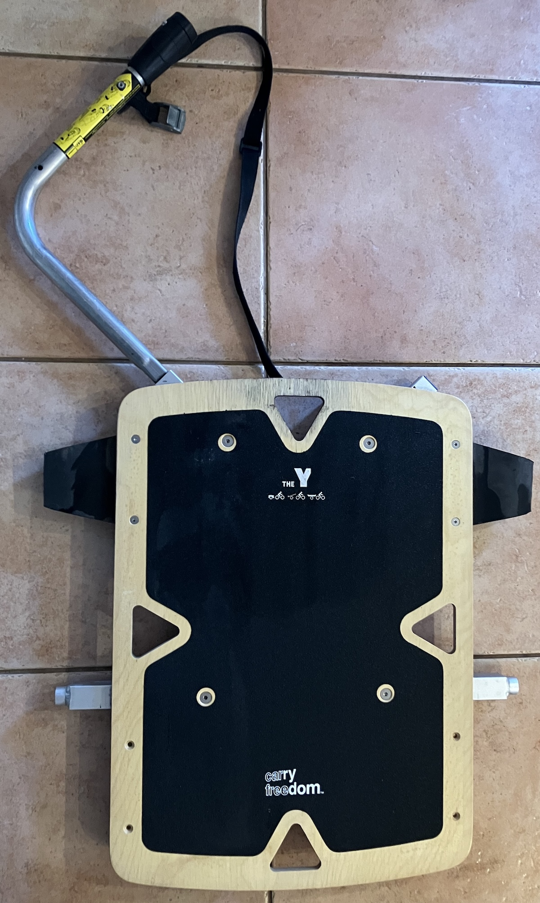

(An unserem Y-Frame ist eine Deichsel für die Weber-Kupplung verbaut, nicht die von Carry Freedom standardmäßig gelieferte Lollipop-Kupplung. Für den Aufbau der Box ist das egal.)

Auf dem Y-Frame haben wir eine [186 Liter Alubox von Alutec](https://www.alutec.net/produkte/classic/) verbaut. Jede andere Alubox tut es auch, aufgrund anderer Abmessungen müssen ggf. die weiter unten angegebenen Maße angepasst werden:

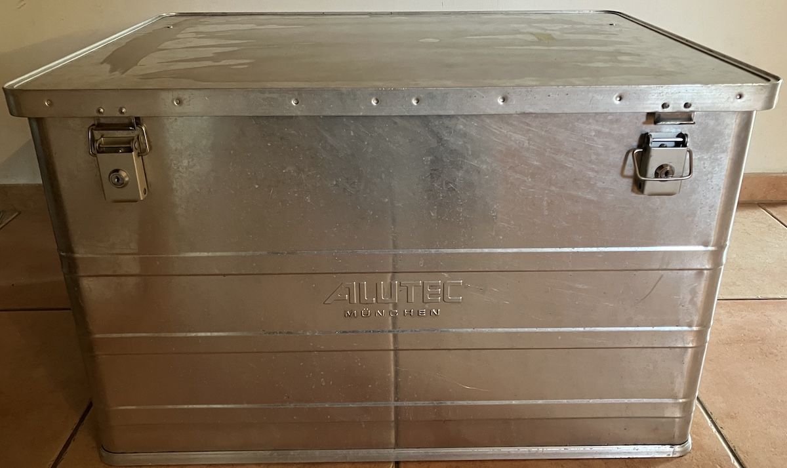

## Benötigtes Material

Zur Montage der Box auf der Platte des Anhängers wird benötigt:

- [Fixierungsfüße von Carry Freedom](https://carryfreedom.com/de/shop/boxen/feet-for-box-fitting-carry-freedom-y-trailer/)
- 4 × M6&nbsp;×&nbsp;40mm Flachkopfschraube mit Innensechskant
- 4 × M6 Stoppmutter
- 4 × M6 Unterlegscheibe ⌀ 22mm
- 4 × [Flachverbinder 80mm&nbsp;×&nbsp;15mm](https://www.bauhaus.info/flachverbinder/alberts-flachverbinder/p/26719694)
- 4 × Moosgummistreifen ca. 64mm&nbsp;×&nbsp;19mm
- 1 × Sperrholzplatte 5mm stark 620mm&nbsp;×&nbsp;480mm
- Etwas doppelseitiges Klebeband

## Montage der Alubox

An den folgenden Positionen mit einem 6mm Metallbohrer Löcher in den Boden der Alubox bohren. Damit der Bohrer auf dem glatten Blech nicht auswandert, vorher einen Körnerpunkt setzen (geht zur Not auch mit einem dicken Nagel). Wichtig ist der relative Abstand der Löcher zueinander (570mm in der langen und 370mm in der kurzen Richtung), damit die Füße zu den dreieckigen Aussparungen in der Bodenplatte des Y-Frame passen. Wer also eine Box mit leicht anderen Dimensionen montiert, muss die absoluten Positionen entsprechend anpassen.

(Dieselbe Zeichnung als [PDF](holes-in-base-plate.pdf).)

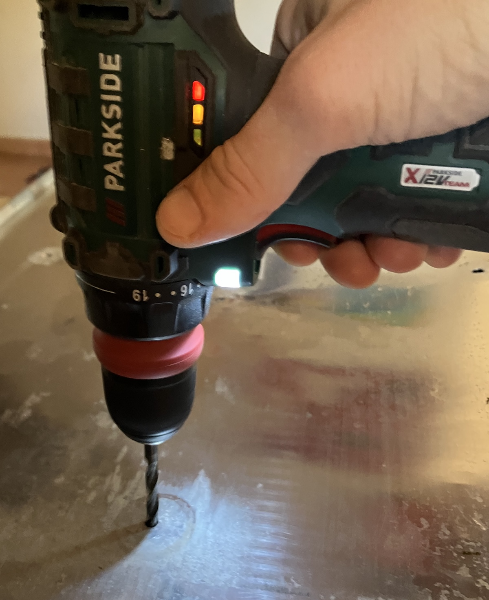

Als nächstes mit einer 39mm Lochsäge vier Löcher an den angegebenen Positionen in die Sperrholzplatte sägen:

(Dieselbe Zeichnung als [PDF](plywood-board.pdf).)

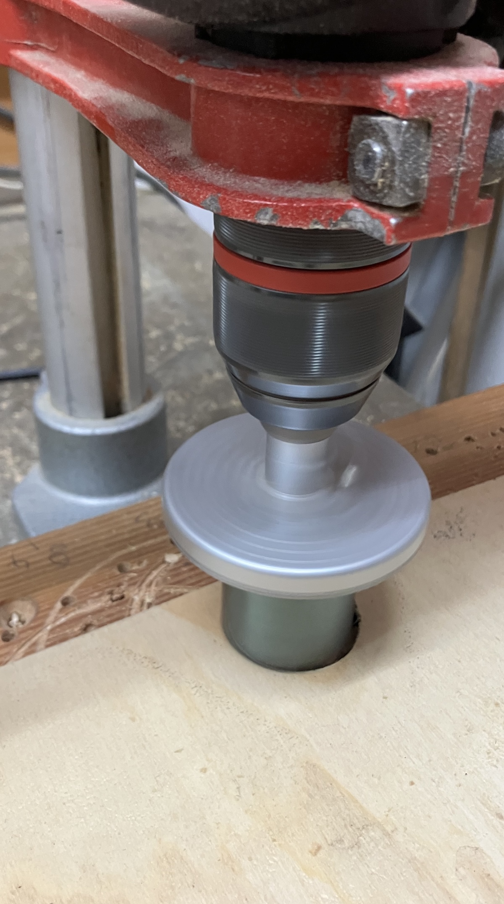

Nun werden die vier Innensechskantschrauben samt Unterlegscheibe durch den Boden der Box gesteckt und die Fixierungsfüße aufgesetzt. Gleichzeitig wird an vier Stellen doppelseitiges Klebeband auf die Unterseite der Box geklebt, um damit die Sperrholzplatte zu fixieren:

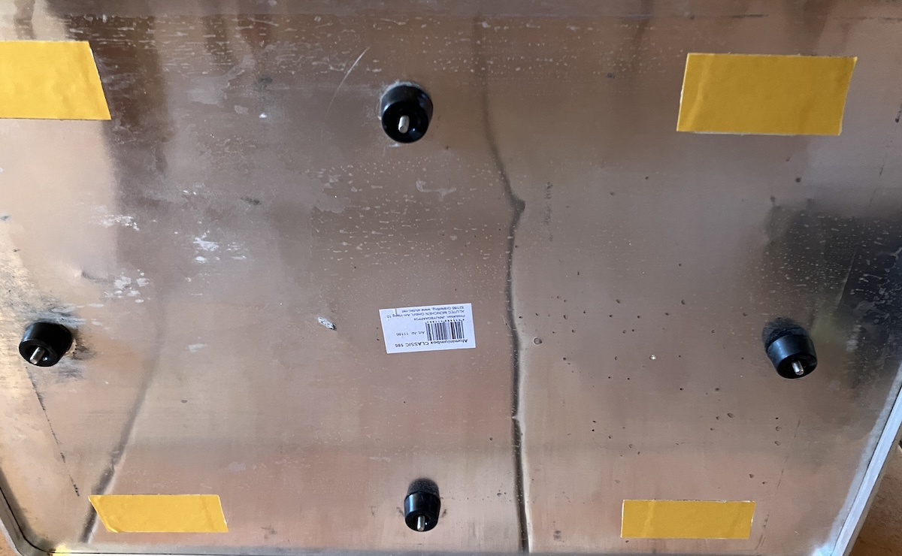

Nun wird die Sperrholzplatte auf die Unterseite der Box geklebt:

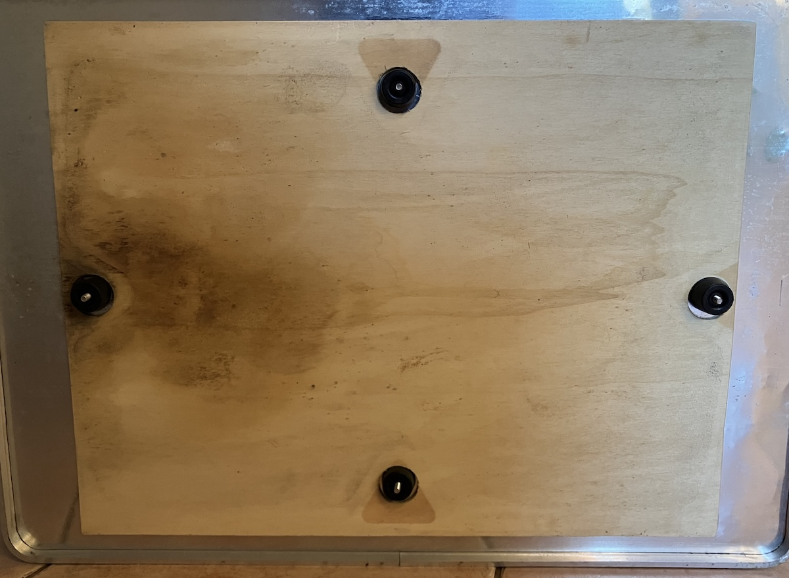

Die Sperrholzplatte sorgt dafür, dass die Fixierungsfüße nicht mehr nach unten durch die Aussparungen der Bodenplatte des Anhängers ragen und wir sie mit Flachverbindern einfach befestigen können.

Da die Flachverbinder kein Loch in der Mitte haben, sägen wir mit einer Metallsäge ein Loch ab, entgraten die Kanten und bohren das mittlere Loch auf 6mm auf. Die Moosgummistreifen versehen wir in der Mitte mit einem Loch für die Schraube, so dass wir vier mal jeweils zueinander passende Flachverbinder und Moosgummistreifen erhalten:

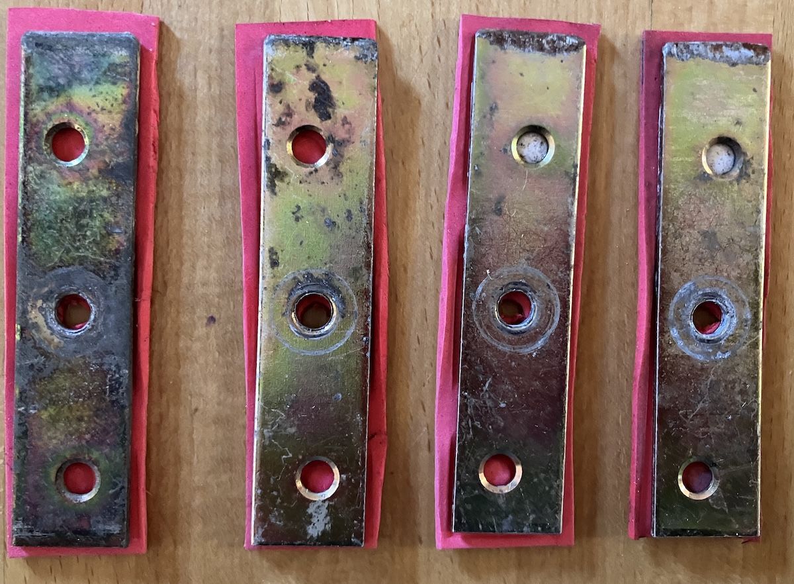

Der nächste Schritt ist alleine etwas fummelig, da wir auf beiden Seiten des Bodens der Box arbeiten müssen. Hier ist eine helfende Hand empfehlenswert.

Wir montieren nun den Y-Frame an die Box. Dazu liegt die Box mit aufgeklapptem Deckel auf einer Längsseite auf dem Boden. Wir hängen den Anhänger über den oberen Fixierfuß, setzen einen Moosgummistreifen und einen Flachverbinder auf die Schraube und ziehen die Mutter fingerfest an:

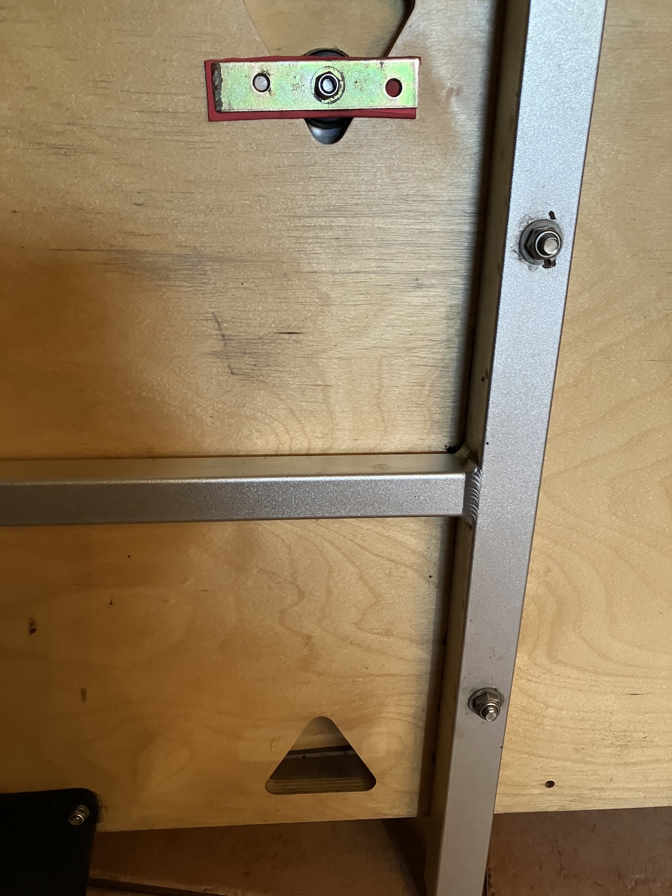

Die drei anderen Füße müssen dabei noch nicht an ihren endgültigen Positionen sitzen. Es ist wichtig, bei diesem Schritt darauf zu achten, dass der Deckel der Box bezogen auf die Deichselseite bzw. Fahrtrichtung richtig angeschlagen ist. Die meisten Leute steigen links vom Rad ab. Daher sollte der Deckel an der rechten Seite angeschlagen sein, damit man nach dem Absteigen nicht einmal um den Anhänger laufen muss, um ihn zu öffnen. (Wer rechts vom Rad absteigt, montiert einfach andersherum.)

Nun werden nacheinander die drei anderen Füße durch die dreieckigen Löcher der Bodenplatte des Y-Frame geführt und die Flachverbinder fingerfest montiert:

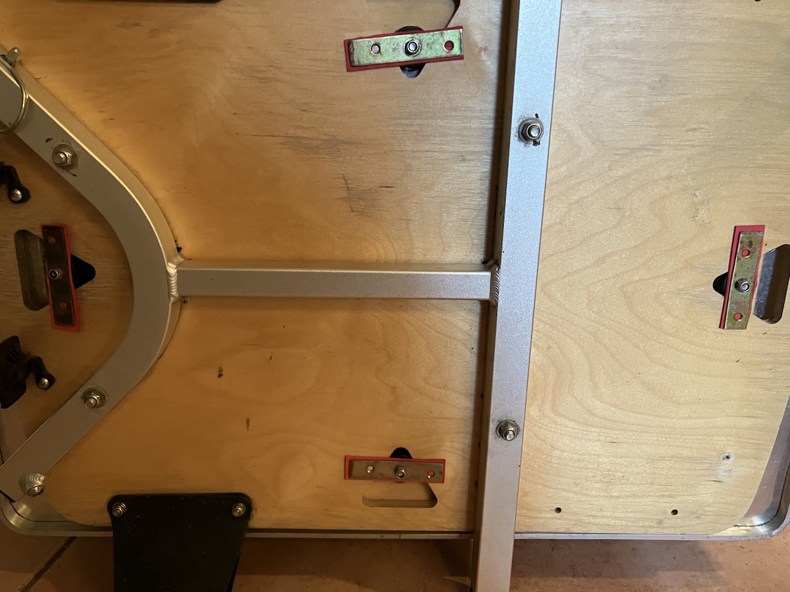

Als letztes werden die Schrauben angezogen, dazu auf der Unterseite mit einem Ring- oder Maulschlüssel die Mutter gegenhalten. Auch dieser Schritt ist leichter zu zweit: eine Person hält die Mutter gegen, die zweite zieht die Schraube an.

Noch die Laufräder anstecken und *fertig!*

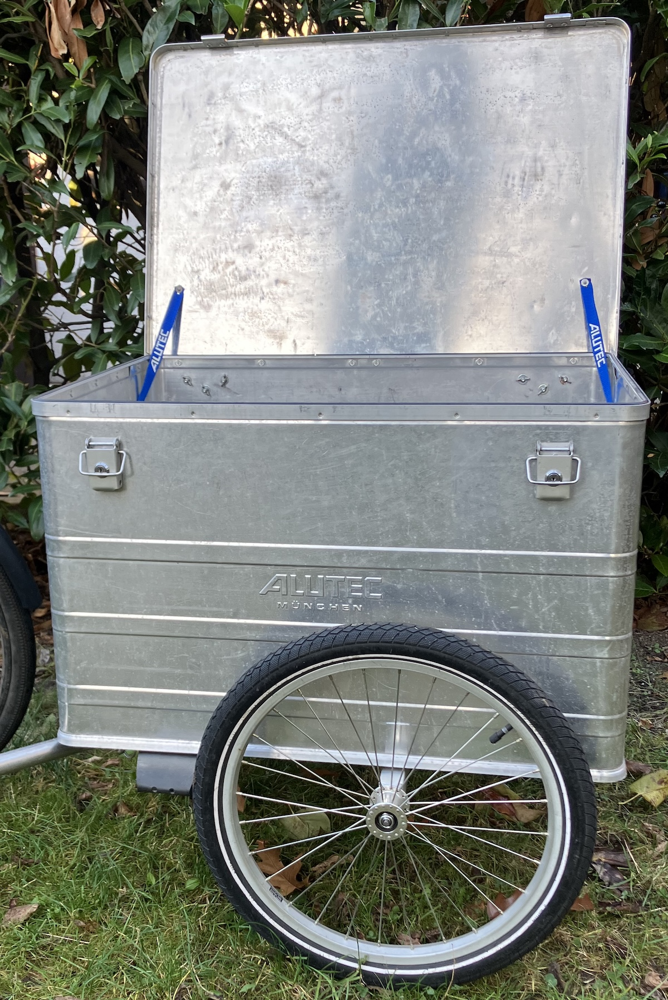

## Mögliche Ausbaustufen

Wer die Kiste auch ohne Deckel benutzen möchte, kann die Nieten, mit denen die Scharniere angebracht sind, vorsichtig mit einem 5mm Bohrer ausbohren und durch Schrauben ersetzen, so dass der Deckel abgenommen werden kann. Das Gleiche gilt für die blauen Bänder, die den Deckel halten.

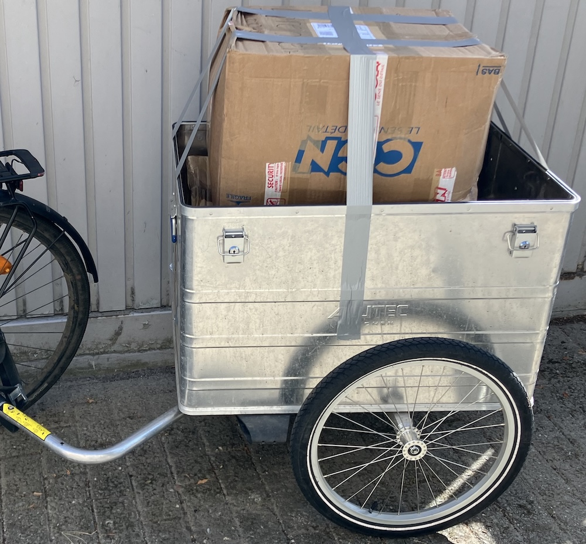

Um die Bänder zu halten, bieten sich M5&nbsp;×&nbsp;15mm Schrauben, 16mm Unterlegscheiben und M5 Flügelmuttern an:

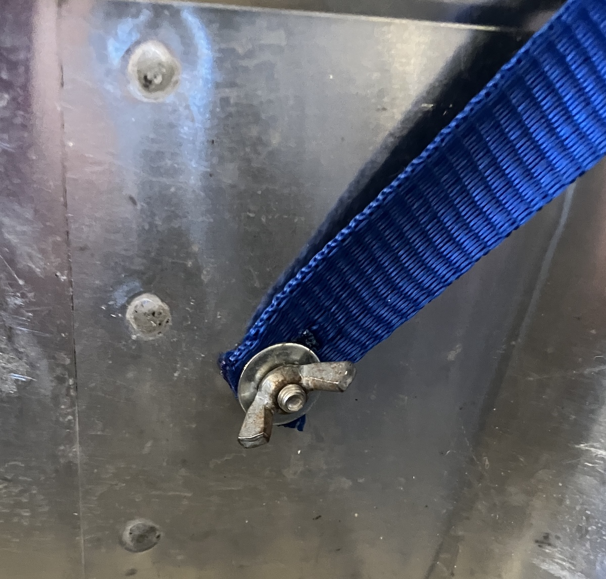

Bei den Scharnieren kann man genauso verfahren. Allerdings ist dann insbesondere das Anbringen des Deckels ziemlich fummelig. Deswegen haben wir uns aus Aluminium einen Aufsatz fräsen lassen, der die Schrauben (M5&nbsp;×&nbsp;25mm) fest aufnimmt. Damit kann man den Deckel einhängen und dann in Ruhe die Flügelmuttern aufdrehen:

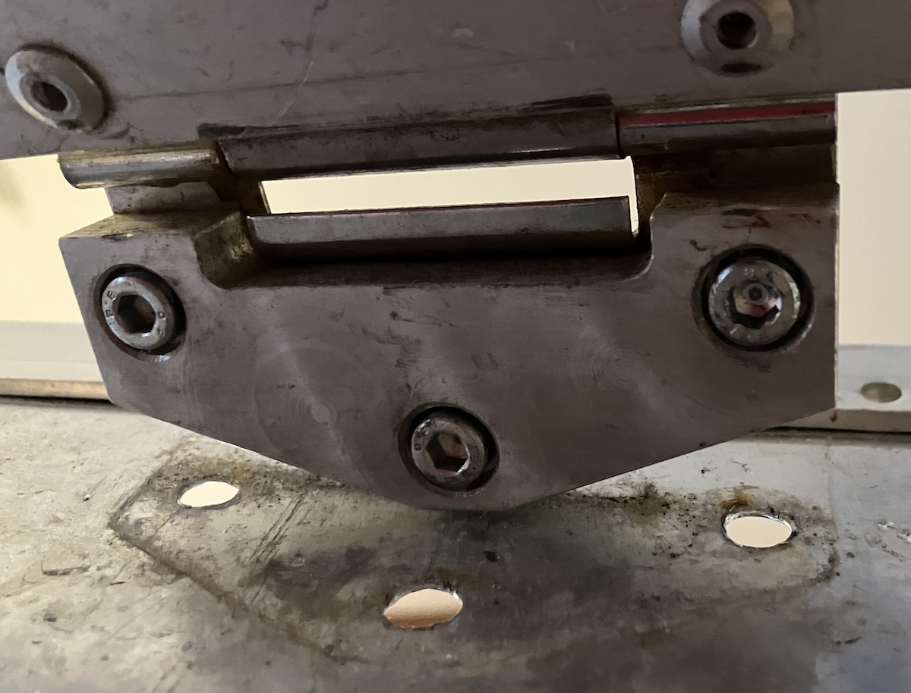
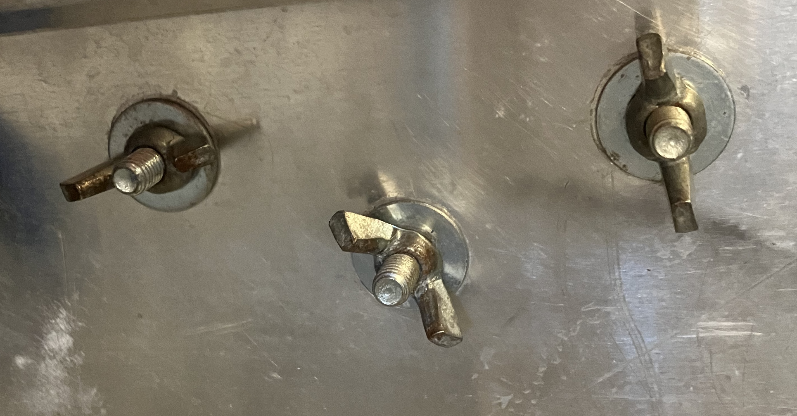

Hier sind die Pläne für den Aufsatz:

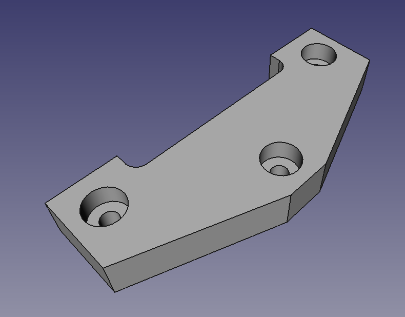

- [Draufsicht](hinge-mounting-topview.pdf)
- [Querschnitt](hinge-mounting-sectional-view.pdf)

In die 4,2mm Kernbohrungen ist dann noch ein M5 Gewinde zu schneiden, das die Schrauben fest aufnimmt. Das Gewinde ist in den Zeichnungen nicht eingezeichnet.
