+++
title = "A do-it-yourself bicycle trunk on wheels"
date = 2026-11-09
description = "Build instructions for a bicycle cargo trailer based on the Carry Freedom Y-Frame."
+++

Anyone who regularly goes shopping by bike knows the feeling: the panniers are, once again, three litres too small, yet another bag is dangling from the handlebar and swinging into the front spokes, or the far too stuffed rucksack is digging into your back. A car boot would be nice right now. If you're looking for a more flexible and cheaper answer to this problem than a cargo bike or a car, here are simple instructions for a bicycle trunk on wheels:

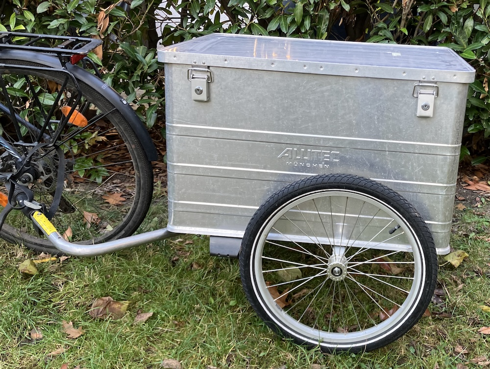

Big enough for two folding crates side by side, lockable (handy when you're visiting several shops), waterproof, and a good fit for any bike:

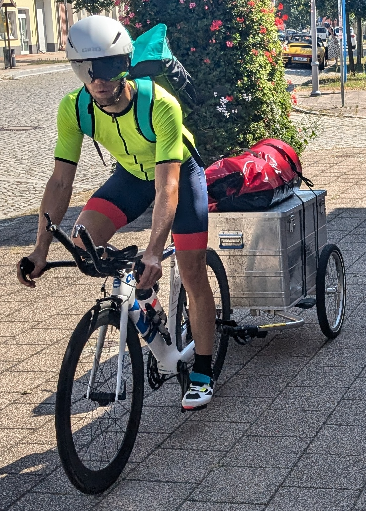

*The photos for the following instructions were taken after the trailer had been in everyday use for a while. So the parts are no longer exactly spotless and show clear signs of wear.*

## The base: a Carry Freedom Y-Frame and an aluminium box

The trailer is built on the large [Y-Frame](https://carryfreedom.com/shop/the-y/the-y-large-version-2-2/) by [Carry Freedom](https://carryfreedom.com/), which has a 50 × 70cm base plate. The one shown here is an older version, which is what we used. The newer ones are the same in all the ways that matter:

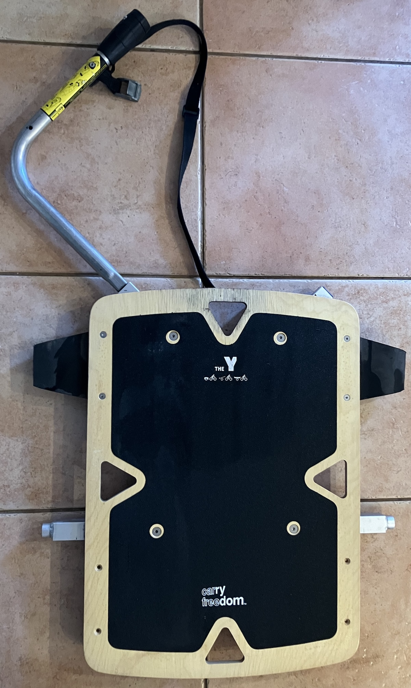

(Our Y-Frame has a drawbar for the Weber hitch rather than the lollipop hitch Carry Freedom supplies as standard. For mounting the box, that makes no difference.)

On the Y-Frame we mounted a [186-litre aluminium box from Alutec](https://www.alutec.net/en/products/classic/). Any other aluminium box will do just fine, due to different dimensions you may have to adjust some measurements given below:

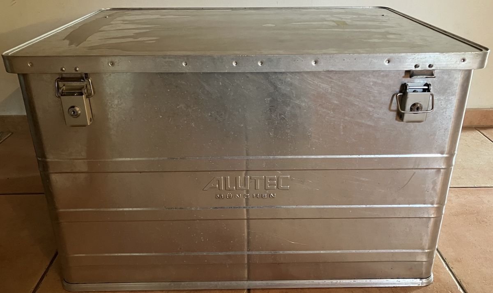

## What you need

To mount the box on the trailer's base plate, you need:

- [Feet for box fitting from Carry Freedom](https://carryfreedom.com/shop/boxes/feet-for-box-fitting-carry-freedom-y-trailer/)
- 4 × M6&nbsp;×&nbsp;40mm button head hex socket screws
- 4 × M6 nylon lock nuts
- 4 × M6 washers, ⌀ 22mm
- 4 × [flat mending plates, 80mm&nbsp;×&nbsp;15mm](https://www.bauhaus.info/flachverbinder/alberts-flachverbinder/p/26719694)
- 4 × foam rubber strips, approx. 64mm&nbsp;×&nbsp;19mm
- 1 × plywood board, 5mm thick, 620mm&nbsp;×&nbsp;480mm
- A bit of double-sided tape

## Mounting the aluminium box

Drill holes in the bottom of the aluminium box at the following positions with a 6mm metal drill bit. To avoid the bit wandering off on the smooth sheet metal, make a centre punch mark first (a thick nail will do at a pinch). What matters is the distance between the holes (570mm in the long direction and 370mm in the short one), so that the feet line up with the triangular cut-outs in the Y-Frame's base plate. If you're mounting a box with slightly different dimensions, adjust the absolute positions accordingly.

(The same drawing as a [PDF](holes-in-base-plate.pdf).)

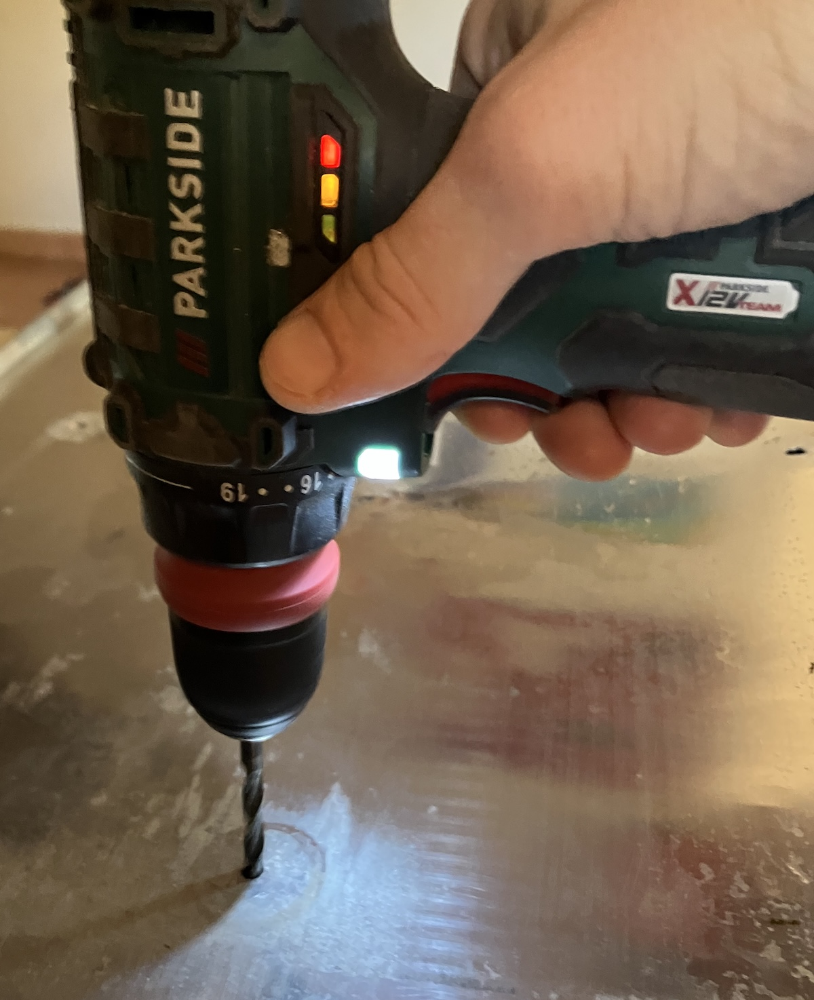

Next, cut four holes in the plywood board with a 39mm hole saw at the positions shown:

(The same drawing as a [PDF](plywood-board.pdf).)

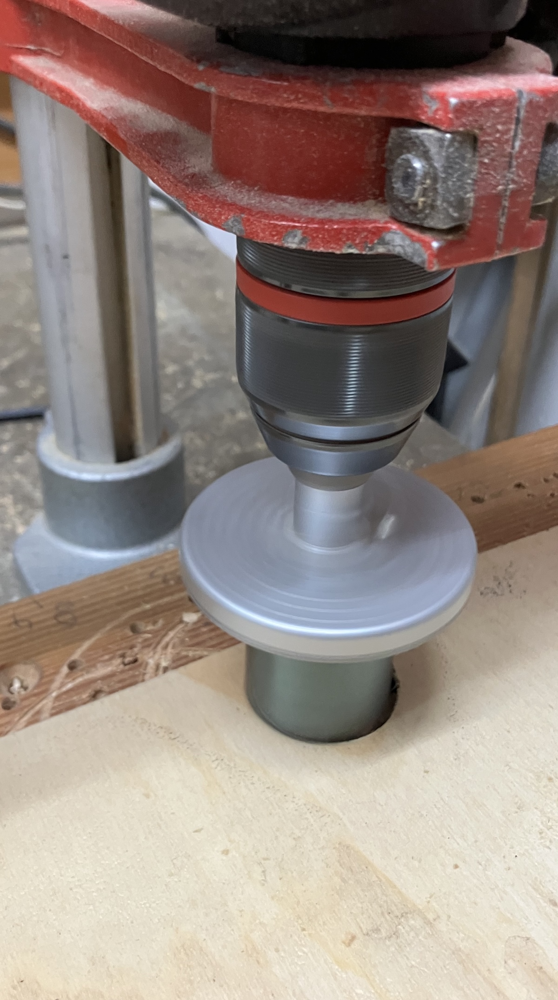

Now push the four hex socket screws, with their washers, through the bottom of the box and put the fitting feet on. At the same time, stick double-sided tape to the underside of the box in four places to hold the plywood board in place:

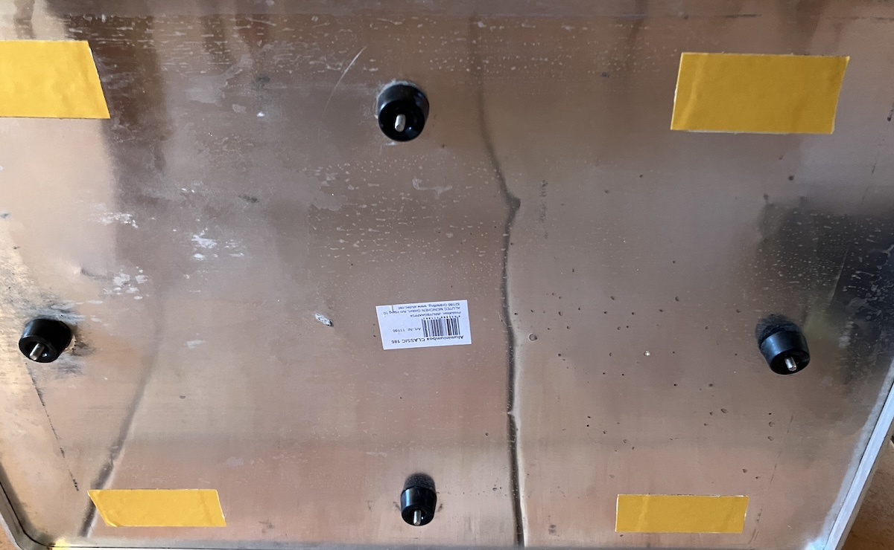

Stick the plywood board to the underside of the box:

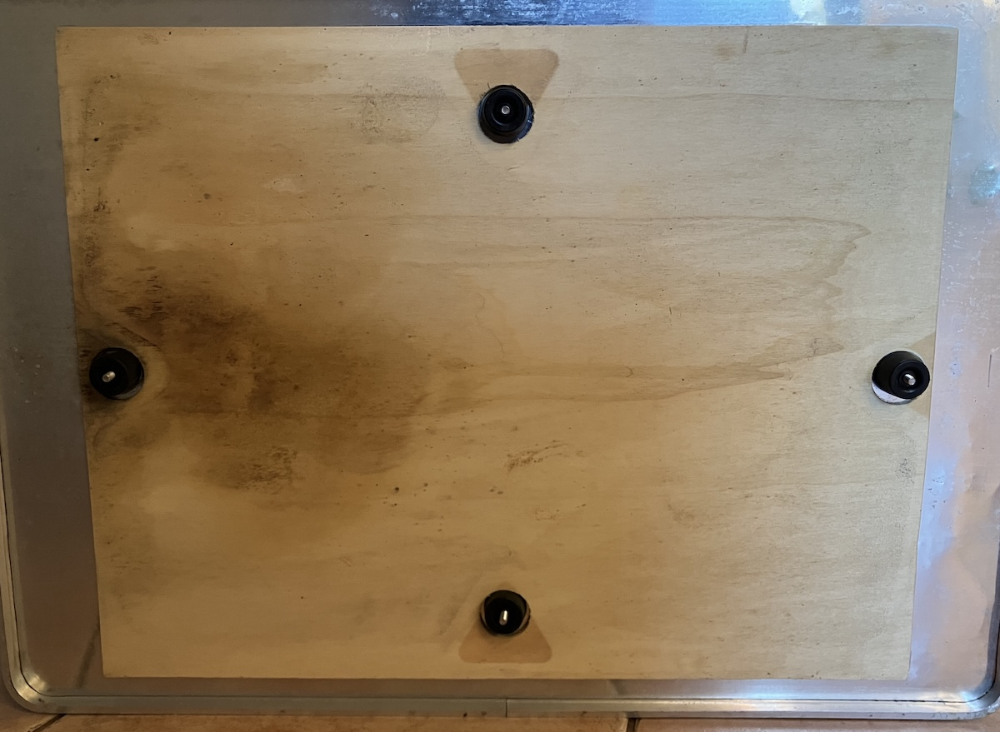

The plywood board makes sure that the fitting feet do not poke down through the cut-outs in the trailer's base plate, such that we can simply fasten them with the flat mending plates.

As the mending plates have no hole in the middle, we saw one hole off with a hacksaw, deburr the edges and drill out the middle hole to 6mm. We punch a hole for the screw in the middle of each foam rubber strip, which leaves us with four matching pairs of mending plates and foam rubber strips:

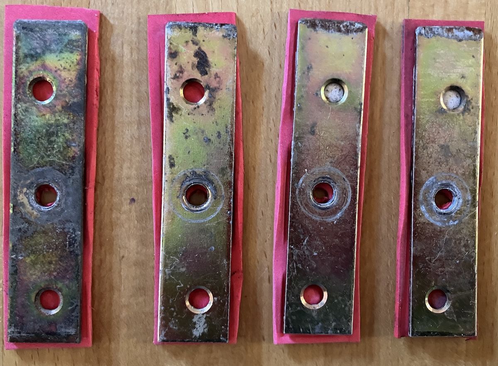

The next step is a bit fiddly on your own, because you have to work on both sides of the box's bottom. A helping hand is a good idea here.

We now mount the Y-Frame on the box. To do this, the box lies on one of its long sides on the floor with the lid open. We hang the trailer over the top fitting foot, put a foam rubber strip and a mending plate on the screw and tighten the nut finger-tight:

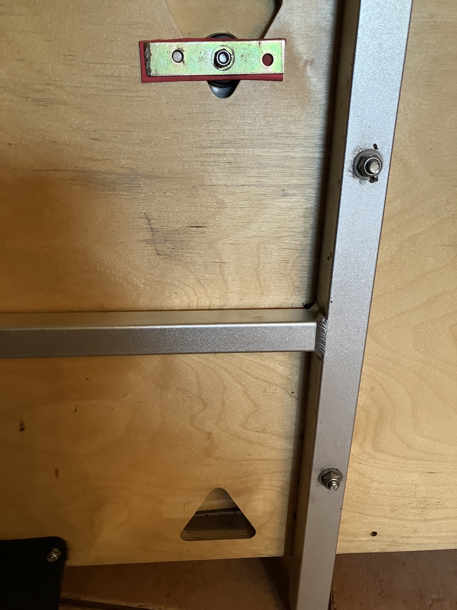

The other three feet don't have to be in their final positions yet. In this step, it's important to make sure the lid is hinged on the correct side relative to the drawbar, i.e. the direction of travel. Most people get off their bike on the left. So the lid should be hinged on the right, so you don't have to go all the way round the trailer to open it after getting off. (If you get off on the right, just mount it the other way round.)

Now guide the other three feet, one after the other, through the triangular holes in the Y-Frame's base plate and fit the mending plates finger-tight:

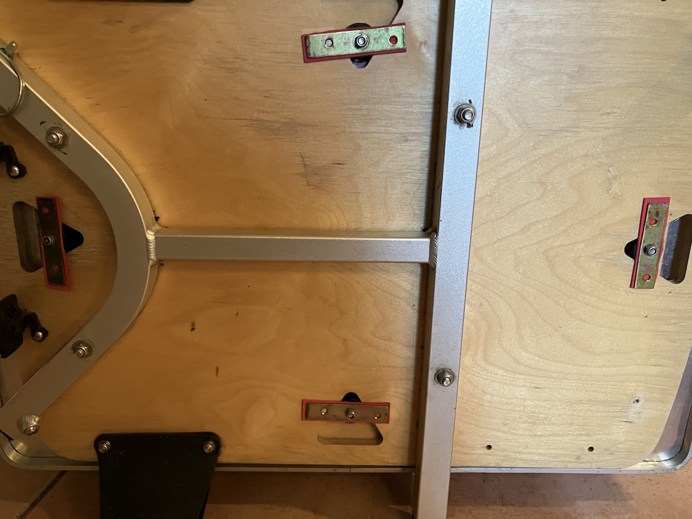

Finally, tighten the screws, holding the nut on the underside with a ring or open-end spanner. This step is also easier with two people: one holds the nut, the other tightens the screw.

Just plug in the wheels and *done!*

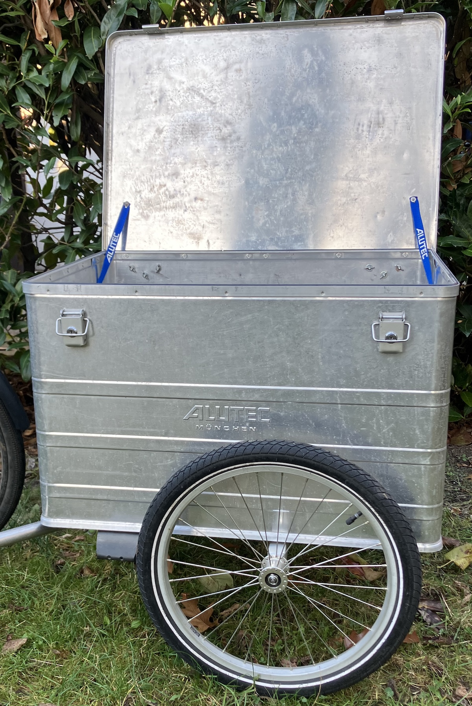

## Possible upgrades

If you'd also like to use the box without a lid, you can carefully drill out the rivets holding the hinges with a 5mm drill bit and replace them with screws, so the lid can be taken off. The same goes for the blue straps that hold the lid.

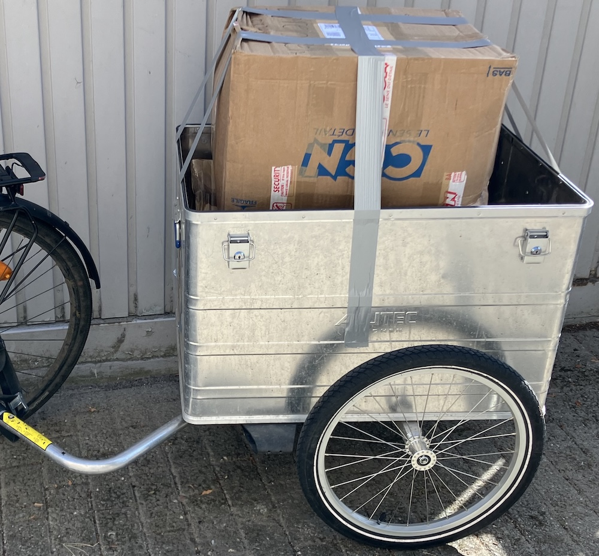

For the straps, M5&nbsp;×&nbsp;15mm screws, 16mm washers and M5 wing nuts do the job nicely:

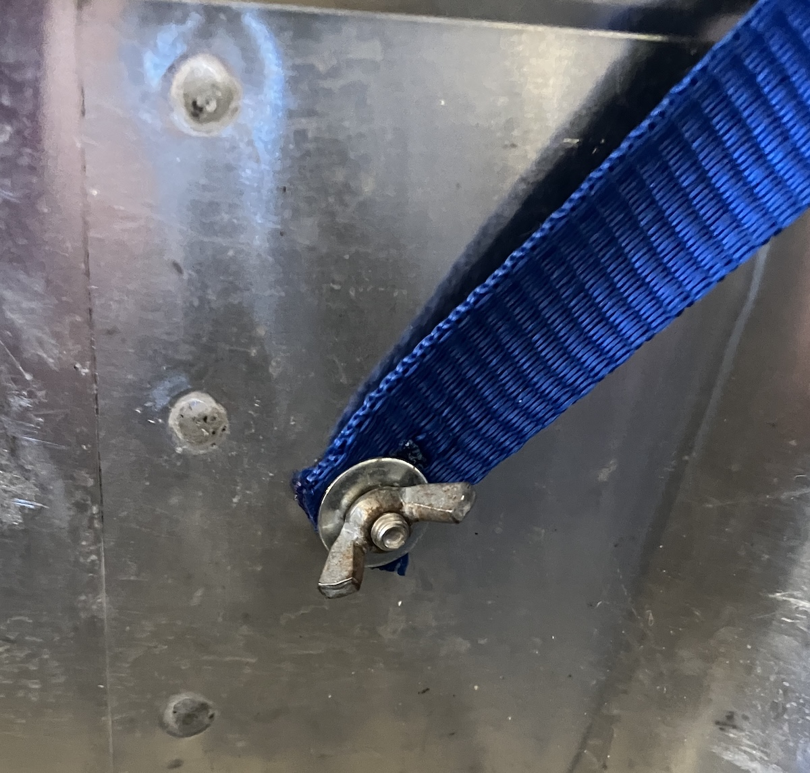

You can do the same with the hinges. However, putting the lid back on then gets pretty fiddly. That's why we had an aluminium mount milled that holds the screws (M5&nbsp;×&nbsp;25mm) firmly in place. That way you can hook the lid in and then screw on the wing nuts at your leisure:

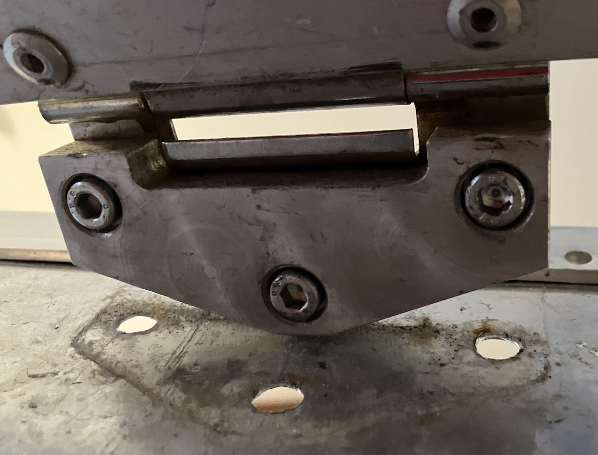
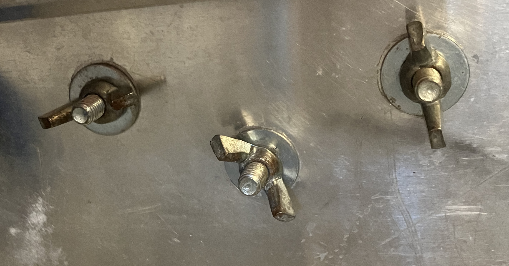

Here are the plans for the mount:

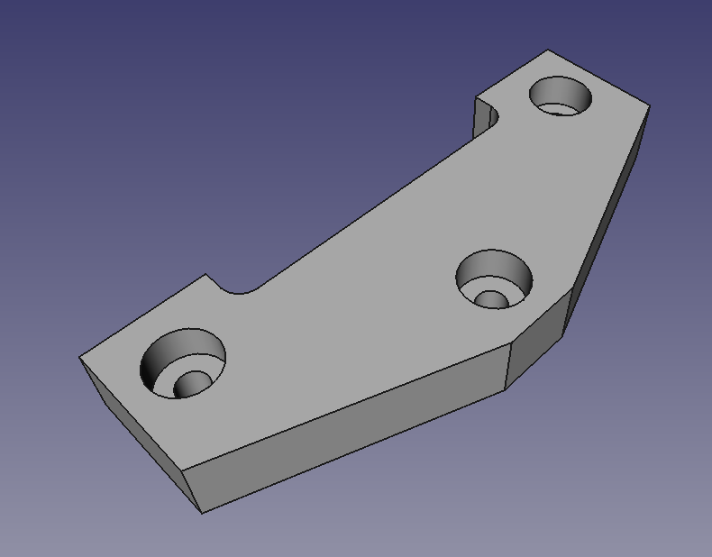

- [Top view](hinge-mounting-topview.pdf)
- [Sectional view](hinge-mounting-sectional-view.pdf)

Finally, cut an M5 thread into the 4.2mm tap drill holes so they hold the screws firmly. The thread isn't shown in the drawings.
